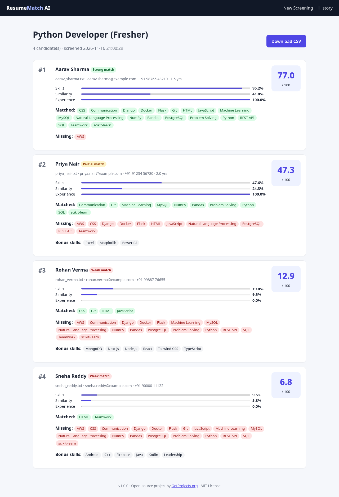
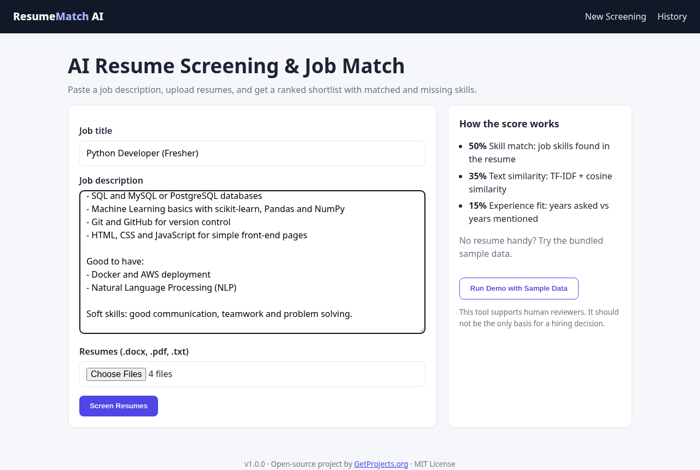
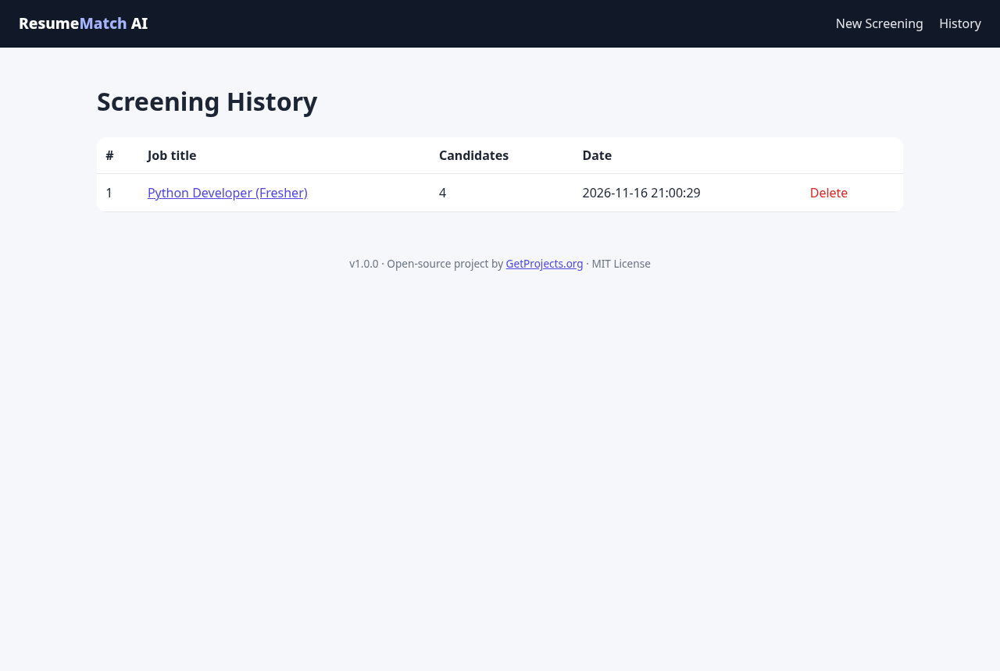
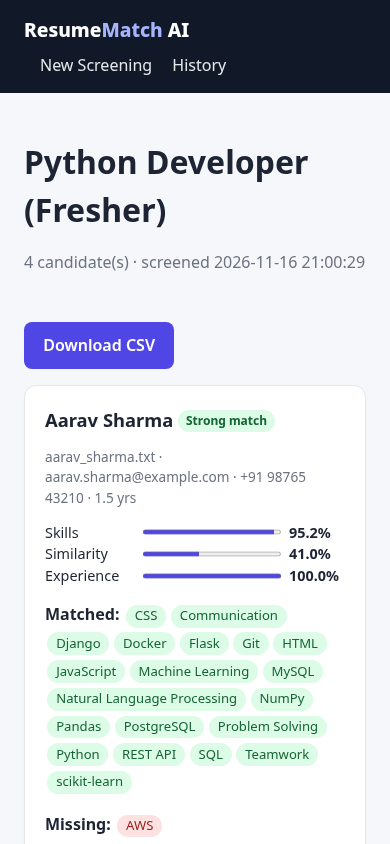

# AI Resume Screening & Job Match System (Python, Flask, NLP)

An open-source **final-year project** for BTech, MCA and BCA students. Paste a job description, upload resumes (PDF, DOCX or TXT), and the app ranks every candidate with a clear **0 to 100 match score**. It shows the matched skills, the missing skills and the reason behind each score.

Built with **Python, Flask, scikit-learn (TF-IDF + cosine similarity) and SQLite**. A full step-by-step tutorial is on **[GetProjects.org](https://getprojects.org/)**.



---

## Features

- Upload up to 25 resumes at once in **PDF, DOCX or TXT** format
- **Skill extraction** from a simple, editable `data/skills.json` dictionary (65+ skills with aliases such as `sklearn`, `ReactJS`, `golang`)
- **Implied skills**: MySQL counts as SQL and Flask counts as Python
- **Explainable score**: 50% skill match + 35% TF-IDF text similarity + 15% experience fit
- Shows **matched, missing and bonus skills** for each candidate, plus a verdict (Strong / Good / Partial / Weak match)
- Picks up the candidate's **name, email, phone and years of experience** automatically
- **Screening history** saved in SQLite. You can reopen or delete any run
- **Download the ranking as CSV**
- One-click **demo** with the bundled sample job description and resumes
- **Command-line tool** for batch screening
- Responsive UI with no front-end build step
- **pytest** test suite (12 tests)

## Tech Stack

| Layer | Technology |
|---|---|
| Language | Python 3.10+ |
| Web framework | Flask 3 |
| NLP / ML | scikit-learn (TfidfVectorizer, cosine similarity), regex skill matcher |
| File parsing | pypdf (PDF), python-docx (DOCX) |
| Database | SQLite (built into Python) |
| Front end | Jinja2 templates, plain CSS |
| Testing | pytest, reportlab (to generate test PDFs) |

## Folder Structure

```
ai-resume-screening-system/
├── app.py                    # Flask app: routes, upload handling, CSV export
├── resume_screener/
│   ├── __init__.py
│   ├── extractor.py          # Read text from PDF / DOCX / TXT
│   ├── skills.py             # Skill dictionary + matcher
│   ├── scorer.py             # TF-IDF similarity, scoring and ranking
│   ├── database.py           # SQLite history
│   └── cli.py                # Command-line version
├── data/skills.json          # Edit this to add your own skills
├── templates/                # base, index, results, history pages
├── static/css/style.css
├── sample_data/
│   ├── job_description.txt
│   └── resumes/              # 4 fictional sample resumes
├── tests/                    # pytest tests
├── docs/screenshots/
├── requirements.txt
├── requirements-dev.txt
├── LICENSE
└── README.md
```

## Setup

```bash
git clone https://github.com/GetProjectsIdea/AI-Resume-Screening-System-in-Python-Flask.git
cd AI-Resume-Screening-System-in-Python-Flask

python -m venv .venv
# Windows: .venv\Scripts\activate
source .venv/bin/activate

pip install -r requirements.txt
```

## Run the Web App

```bash
flask --app app run
```

Open http://127.0.0.1:5000. Click **Run Demo with Sample Data**, or paste your own job description and upload resumes.

## Run from the Command Line

```bash
python -m resume_screener.cli sample_data/job_description.txt sample_data/resumes --csv ranking.csv
```

```
Rank Candidate               Score  Verdict         Missing skills
------------------------------------------------------------------------------
1    Aarav Sharma             77.0  Strong match    AWS
2    Priya Nair               47.3  Partial match   AWS, CSS, Django, Docker, Flask, ...
3    Rohan Verma              12.9  Weak match      AWS, Communication, Django, ...
4    Sneha Reddy               6.8  Weak match      AWS, CSS, Communication, ...
```

## Run the Tests

```bash
pip install -r requirements-dev.txt
python -m pytest -q
```

## How the Score Is Calculated

```
score = 100 × (0.50 × skill_match + 0.35 × text_similarity + 0.15 × experience_fit)
```

- **skill_match** is the share of the job description's skills that are found in the resume.
- **text_similarity** is the TF-IDF cosine similarity between the job description and the resume, scaled to a 0 to 1 range.
- **experience_fit** compares the years the resume mentions with the years the job asks for (for example, "1+ years").

You can change the weights in `resume_screener/scorer.py`, and you can add skills in `data/skills.json`.

## Screenshots

| Upload | Results | History | Mobile |
|---|---|---|---|
|  |  |  |  |

## Future Enhancements

- Use spaCy or sentence-transformer embeddings for semantic matching (for example, "ML" vs "predictive modelling")
- Add an education and CGPA filter, plus must-have vs nice-to-have skills
- Add login for HR users and a candidate status pipeline (shortlisted, interview, rejected)
- Add a REST API endpoint and a React front end
- Deploy on Render or Railway with Docker

## Responsible Use

This is a learning project. Automated scores can be wrong or biased, so use the output to **support** a human reviewer and never as the only basis for a hiring decision. Before deploying it publicly, add CSRF protection, authentication and a proper `SECRET_KEY`.

## License

[MIT](LICENSE) © 2026 GetProjects.org. Free to use, modify and submit as your project. A star ⭐ on the repo is appreciated!
